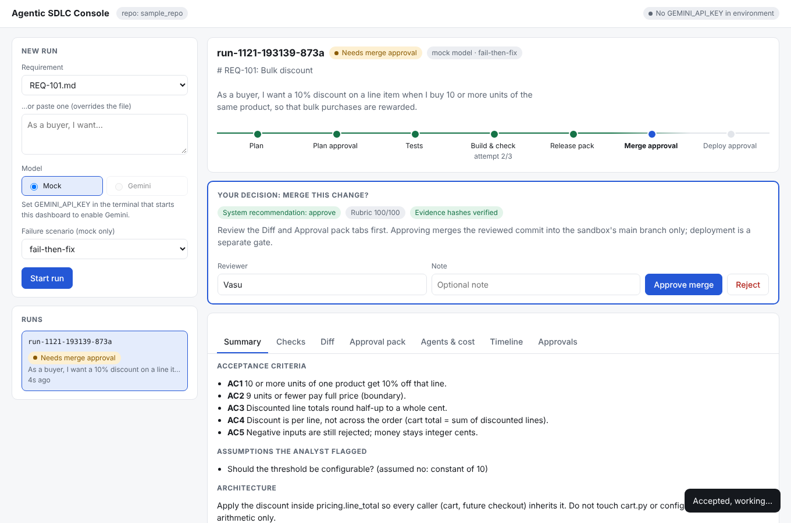

# Agentic SDLC: autonomous engineering with humans in control

Seven specialised agents take a requirement and a repository through analysis, architecture, test
authoring, implementation, automated checks, security review and release packaging. The pipeline then
**stops for a human**, who approves the plan, the merge and the deploy as three separate decisions.

```
requirement -> analyst -> architect -> [HUMAN: plan] -> qa -> developer <--+  feedback, max 3 attempts
                                                                  |        |
                          tools decide: pytest | lint | security scan | baseline diff
                                                                  v  fail -+
                                          security agent -> rubric -> release agent
                                      [HUMAN: merge the reviewed commit] -> [HUMAN: deploy (mock)]
```



## Setup

Python 3.10+, `git` on PATH, and `pip install -r requirements.txt` (pytest). Nothing else: HTTP, UI and
server are standard library.

**Windows (PowerShell)**: set the key for this terminal only, then start from that same terminal:
```powershell
$env:GEMINI_API_KEY = "GEMINI_API_KEY"        # or: setx GEMINI_API_KEY "..." and open a new terminal
$env:GEMINI_MODEL   = "gemini-3.1-flash-lite"  # optional; default shown. Use any model your key can access
python cli.py check-llm                        # ONE tiny call: confirms key, model, network
python cli.py dashboard                        # http://127.0.0.1:8765
```
macOS/Linux: `export GEMINI_API_KEY=...` instead. The key is read from the environment only; it is sent in
a request header, never written to disk, never shown in the UI, and redacted from every error message.

Optional: `GEMINI_PRICE_IN_PER_1M` / `GEMINI_PRICE_OUT_PER_1M` (dollars) turn token counts into cost
estimates (default 0, i.e. free tier/unpriced). `GEMINI_FALLBACK_MODEL` adds a second model for failover.

## Use it

**Dashboard** (`python cli.py dashboard`): start a run (Mock or Gemini), watch the pipeline, read the
checks, the diff and the approval pack, and click the three decisions. Reload and nothing is lost.
Everything is persisted, and a run that paused because the model was unavailable has a Resume button.

**CLI**
```bash
python cli.py run --requirement requirements/REQ-101.md                 # mock model, failing-check demo
python cli.py run --requirement requirements/REQ-101.md --provider gemini
python cli.py approve-plan RUN approve --by you
python cli.py report RUN                  # timeline, per-agent tokens/cost/latency, approvals, rubric
python cli.py decide RUN approve --by you  # merge gate: re-verifies evidence hashes first
python cli.py deploy RUN approve --by you  # deploy gate (mocked: writes a request file)
python -m pytest tests -q                  # 99 tests, ~80 s
```

## What is real and what is mocked

| | Mock provider (default) | Gemini provider |
|---|---|---|
| Agent reasoning | scripted per scenario (REQ-101 only) | real model, any requirement |
| File writes, git branch/commit/merge | real | real |
| pytest, lint, security scan, baseline diff | real | real |
| Token counts | estimated (chars/4) | reported by the API |
| Failure scenarios | injected by `--scenario` | whatever the model actually does |

**The Gemini path has been tested end to end over HTTP against a local fake that speaks Gemini's
`generateContent` wire format** (headers, JSON mode, usage metadata, 429/5xx/4xx, safety blocks, truncation,
redirects, key redaction). It has **not** been run against Google's real API from the build sandbox, which
has no route to it. Run `python cli.py check-llm` first; if your model name or key is wrong it says so in one line.

## Where autonomy stops (trust boundaries)

| The orchestrator never takes this on an agent's word | What it does instead |
|---|---|
| Which files may change | Sandbox preflight: approved paths only, never protected paths (`.agentignore`, config, CI), size-capped, validated before anything is written |
| Test results | Runs the tools itself; the release table is built from tool output, the model only writes the narrative |
| Security verdict | AST scanner overrules the security agent |
| Test validity | QA's tests must pass against a **held-out reference** it never sees, else they are rejected; they must also fail on the unmodified code (TDD red) |
| Scope widening | An architect "accept" never widens scope; it escalates. Only a human re-approving a plan can |
| Evidence | REVIEW.md, the patch and the commit are hashed; merge re-checks all three and merges **exactly the reviewed commit** |
| Decisions | One per gate (database UNIQUE constraint), a named reviewer required, each gate valid only in its state |
| Generated code | Differential check runs it in a subprocess, never in the orchestrator process |

## Failure scenarios (each has tests)

| Scenario | Response |
|---|---|
| Architect and developer disagree | 2 negotiation rounds via `architect_review`, then escalate to a human |
| Generated code fails tests | Real output fed back; failed attempt reset away; max 3, then blocked |
| Critical security finding | Scanner wins; retry with feedback, then block |
| Malformed / wrong-shape model output | Deep schema validation, re-prompt with the error (max 2), then fail the run |
| Provider unavailable mid-run | Retry with backoff (honours `Retry-After`), optional failover, else **pause**; Resume continues without redoing finished agents |
| Bad API key / blocked prompt | Fatal: not retried, run fails with a redacted message |
| Repeated action / unrelated file | Whole write set rejected before touching disk; an identical answer gets one corrective re-prompt, a second one escalates to a human |
| QA writes a wrong expected value | Reference oracle rejects the tests; the developer is never blamed |

## Security model of the dashboard

Loopback only; Host header checked (DNS rebinding); per-session token on every POST (CSRF); 16 KB body
cap; run ids validated; strict CSP with a nonce; the UI never uses `innerHTML`, so model output renders as
text. Single reviewer on one machine: reviewer names are self-reported.

## Limitations

- Sandbox isolates **writes** (copy + git branch + path rules). It is not an OS sandbox: tests execute
  generated code on your machine. Production needs a container with no network and resource limits.
- The mock agents are scripted for REQ-101 only. The Gemini path is generic, but the reference oracle and
  baseline diff exist only for REQ-101 (`baselines/REQ-101.py`). Other requirements run with those checks
  skipped (clearly marked) and the rubric rescaled, so QA's tests are not oracle-validated there.
- Lint and security scan are small AST checks, not ruff or a real SAST tool. Lint is **advisory** (shown as a warning, costs rubric points, never blocks); the security scan, tests and baseline diff are hard gates.
- Python repositories with pytest only; sequential runs; SQLite; no authentication.
- Default model name `gemini-3.1-flash-lite` could not be verified from the build sandbox; override it
  with `GEMINI_MODEL`. Dollar costs are estimates from prices you supply.
- A deadlocked scope dispute has no "widen scope" button: the human starts a new run with a revised plan.
